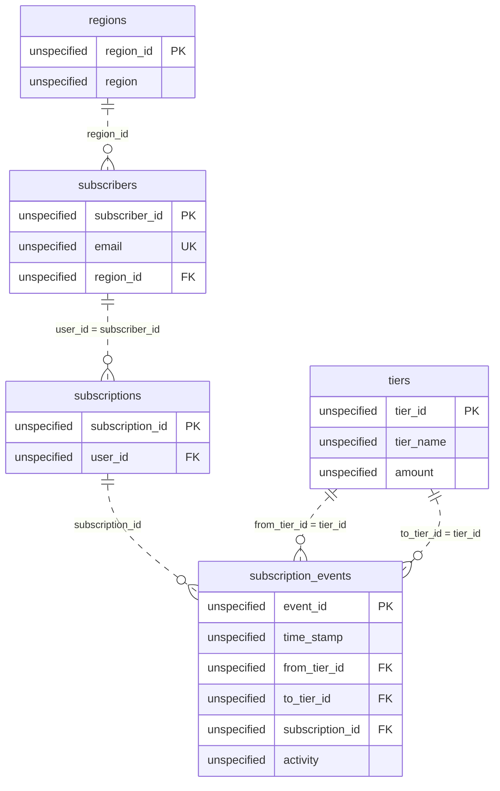

# The Churner Who Came Back

*They cancelled. They came back. The report has to tell both stories correctly.*

[Data Modeling · Hard · on DataDriven](https://datadriven.io/problems/the_churner_who_came_back)

## How it went

| | |
|---|---|
| Solved | 2026-10-18 |
| Accepted | on the 6th submission |
| Hints | 2 hints |
| Concepts | Attributes, Dimension Tables, Entities, Fact Tables, Foreign Keys, Grain Definition, Key Generation, Many-to-Many, Metric Additivity, OLAP Cubes, One-to-Many, Primary Keys, SCD Type 2, Star Schema, Surrogate Keys |

## The design

The accepted design is in [`schema.sql`](./schema.sql) as DDL and in [`schema.json`](./schema.json) as JSON.
