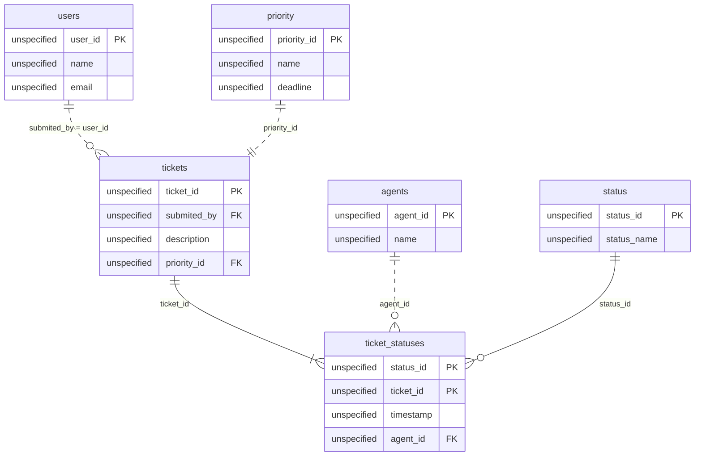

# The Vanishing State

*A status column forgets the moment it changes. Model the schema that remembers.*

[Data Modeling · Easy · on DataDriven](https://datadriven.io/problems/the_vanishing_state)

## How it went

| | |
|---|---|
| Solved | 2026-10-30 |
| Accepted | on the first submission |
| Hints | 2 hints |
| Concepts | Attributes, Constraints, Data Types, Dimension Tables, Entities, Event Sourcing, Fact Tables, Foreign Keys, Grain Definition, Immutable Logs, Indexing, Metric Additivity, One-to-Many, Pre-Aggregation, Primary Keys, Star Schema |

## The design

The accepted design is in [`schema.sql`](./schema.sql) as DDL and in [`schema.json`](./schema.json) as JSON.
